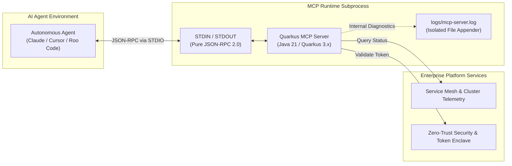

# Quarkus Enterprise MCP Platform Tools

[](https://github.com/joehajas/quarkus-mcp-platform-tools/actions)
[](https://openjdk.org/)
[](https://quarkus.io/)
[](https://modelcontextprotocol.io/)
[](LICENSE)

An enterprise-grade **Model Context Protocol (MCP)** server implemented in **Java 21** using the **Quarkus** framework. This daemon exposes cloud-native platform telemetry, operational diagnostics, and Zero-Trust identity verification routines to autonomous AI agents (Claude Desktop, Roo Code, Cursor) over standard input/output (`STDIO`).

---

## Architecture

The server acts as an MCP Subprocess Host implementing the open JSON-RPC 2.0 specification over standard I/O:



### Architectural Highlights
- Zero-Pollution STDIO Protocol: MCP strictly requires uncorrupted JSON-RPC communication across stdin and stdout. Console logging is disabled; all internal Quarkus runtime diagnostics, build metadata, and telemetry are isolated to logs/mcp-server.log.

- Strongly-Typed Domain Contracts: Uses immutable Java 21 record constructs for strict schema generation and type safety, avoiding untyped map serialization.

- Multi-Primitive MCP Implementation: Implements both @Tool operations for execution and @Prompt templates for structured incident triage workflows.

- Build-Time Optimization: Employs Quarkus compile-time reflection indexing (quarkus-mcp-server-stdio) to eliminate runtime reflection overhead.

### Available Capabilities
1. Tools (@Tool)

| Tool Identifier | Parameters | Description | Return Type |
| :--- | :--- | :--- | :--- |
| `checkServiceHealth` | `serviceName` (string) | Checks cluster state, uptime, active VLAN, and latency for a target platform service. | `HealthReport` |
| `inspectClientSecurity` | `clientId` (string) | Inspects OAuth2/OIDC token state, assigned RBAC scopes, and Zero-Trust boundary isolation. | `SecurityValidation` |

2. Prompts (@Prompt)
| Prompt Identifier | Arguments | Description |
| :--- | :--- | :--- |
| `triageIncident` | `component` (string), `symptom` (string) | Generates a structured multi-step SRE root-cause analysis workflow for an LLM agent. |

## Getting Started
Prerequisites
- Java 21 SDK (Eclipse Temurin, OpenJDK, or GraalVM)
- Git

Build the Application
Compile the code and assemble the fast-jar distribution using the Gradle wrapper:

```Bash
./gradlew build
```
This compiles classes, executes automated unit tests, and creates the fast-jar distribution under build/quarkus-app/.

Run Unit Tests
```Bash
./gradlew test
```

## AI Host Configuration
To connect this server to an autonomous agent host, register the compiled runner jar in the client's configuration file.

### Claude Desktop Integration
Add the following definition to your configuration file:
- macOS: ~/Library/Application Support/Claude/claude_desktop_config.json
- Windows: %APPDATA%\Claude\claude_desktop_config.json

```JSON
{
  "mcpServers": {
    "platform-tools": {
      "command": "java",
      "args": [
        "-jar",
        "/ABSOLUTE/PATH/TO/quarkus-mcp-platform-tools/build/quarkus-app/quarkus-run.jar"
      ]
    }
  }
}
```
### Roo Code / Cursor Integration
Under your agent's MCP settings, add:

```JSON
{
  "mcpServers": {
    "quarkus-platform-tools": {
      "command": "java",
      "args": [
        "-jar",
        "/ABSOLUTE/PATH/TO/quarkus-mcp-platform-tools/build/quarkus-app/quarkus-run.jar"
      ],
      "disabled": false,
      "autoApprove": []
    }
  }
}
```

## Protocol Verification & Trace Example
During agent execution, tool calls are processed over STDIO using standard JSON-RPC 2.0 packets:

### Example: Tool Call Request
``` JSON
{
  "jsonrpc": "2.0",
  "id": "1",
  "method": "tools/call",
  "params": {
    "name": "checkServiceHealth",
    "arguments": {
      "serviceName": "billing-engine"
    }
  }
}
```

### Example: Tool Call Response
```JSON
{
  "jsonrpc": "2.0",
  "id": "1",
  "result": {
    "content": [
      {
        "type": "text",
        "text": "{\"service\":\"billing-engine\",\"status\":\"HEALTHY\",\"latencyMs\":18,\"activeVlan\":\"VLAN-PROD-20\",\"timestamp\":\"2026-10-23T11:00:00Z\",\"activeNodes\":[\"node-eu-west-1a\",\"node-eu-west-1b\"]}"
      }
    ],
    "isError": false
  }
} 
```

## Container Packaging
A production-grade multi-stage container build based on Red Hat Universal Base Image (UBI 9) minimal runtime is available:

```Bash
docker build -f src/main/docker/Dockerfile.jvm -t quarkus-mcp-platform-tools:latest .
```

## License
Licensed under the Apache License, Version 2.0.